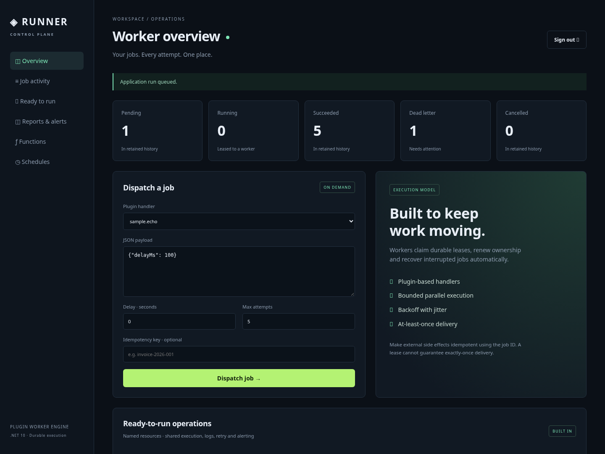
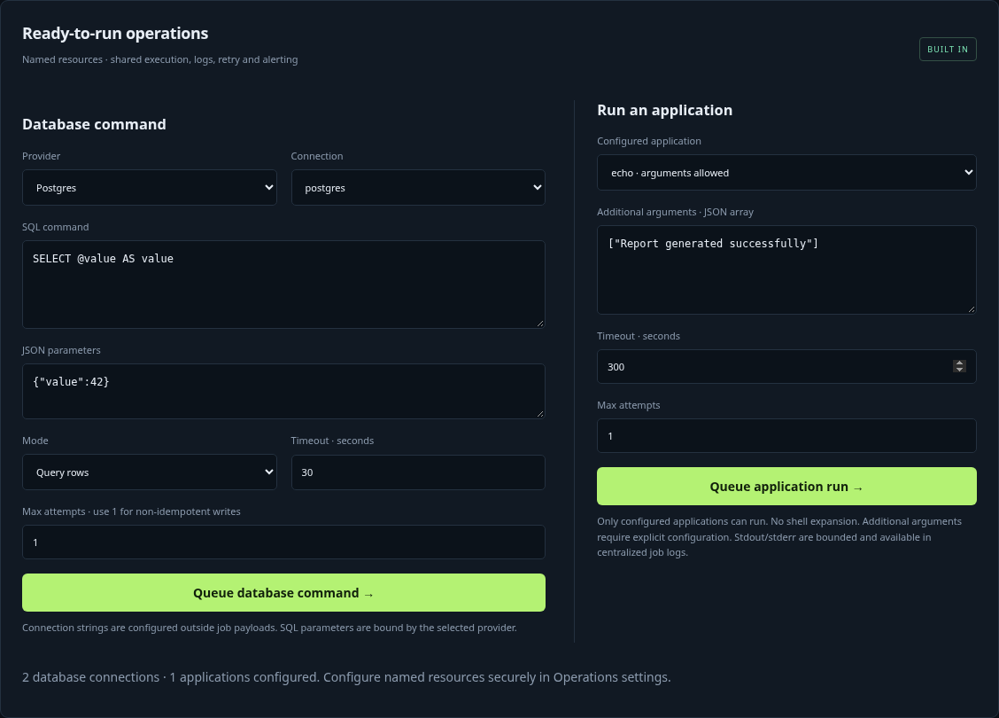
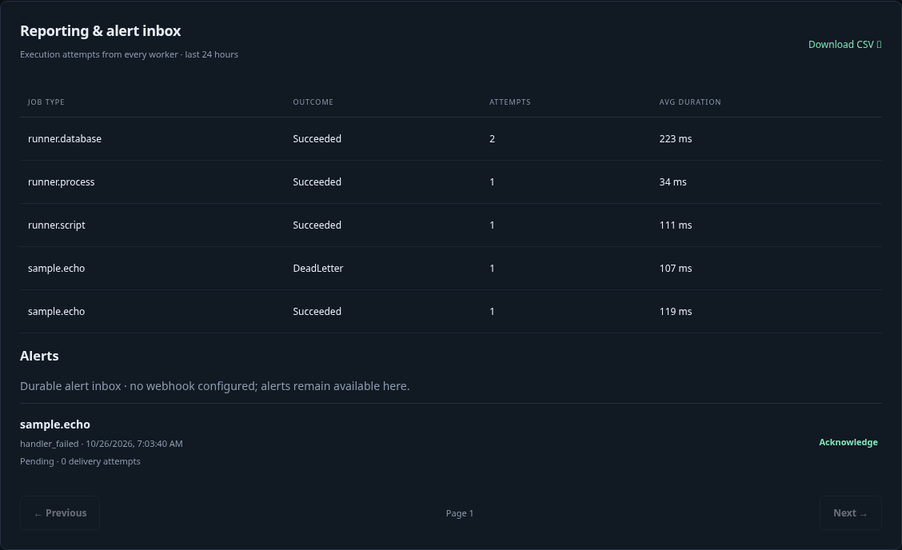
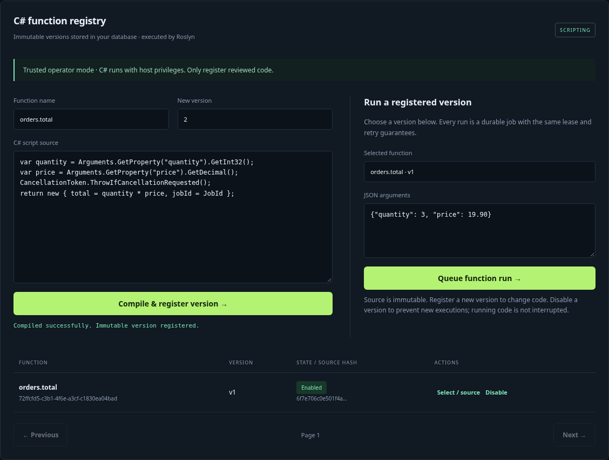
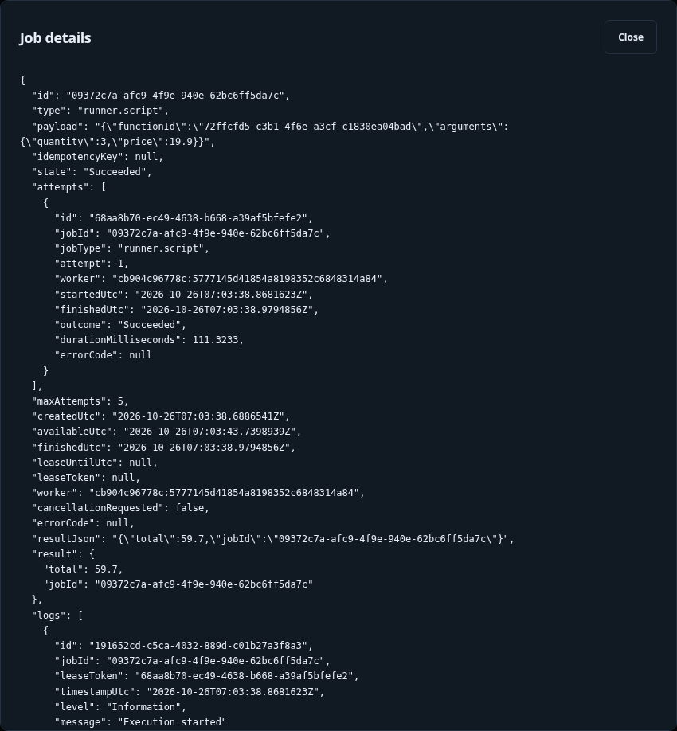
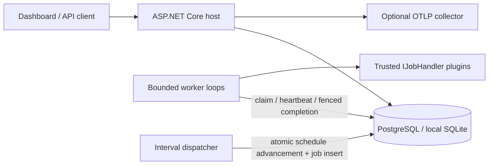

# Runner

A plugin-based durable worker with an operations dashboard, built with .NET 10 and the latest C# for cloud and on-premises deployments. Runs without Quartz, Hangfire, or Redis. Workers keep durable job state in the database and coordinate through it.

**Status:** a working, tested foundation. Complete the operational requirements below before production deployment. Load testing, an independent security review, and validation in a real deployment have not yet been performed.

## Dashboard

Real screenshots captured from the running application. The function registry is enabled for these screenshots.



<details>
<summary>C# function registry and persisted job results</summary>









[View the mobile dashboard](docs/images/dashboard-mobile.png)

</details>

## Quick start

Requirements: the .NET 10 SDK specified in `global.json`, Bash, and OpenSSL. Node.js is not required.

```bash
dotnet restore Runner.sln --locked-mode
dotnet build Runner.sln -c Release --no-restore
dotnet test tests/Runner.Tests -c Release --no-build
bash scripts/dev.sh
```

The development server uses port 5080. Sign in with the local key stored in `src/Runner.Host/data/operator.key`. The key is generated on first startup and excluded from Git. The SQLite database and cookie keys are persisted under `data/`. Use `scripts/dev.sh` for local development only; do not use the Development environment in production.

The dashboard includes live state counters, handler selection, JSON payloads, delayed dispatch, idempotency keys, state filtering, pagination, cancellation, dead-letter retries, and fixed-interval schedule management. It has no UI framework or CDN dependencies.

## Architecture



- `Runner.Contracts`: a small handler contract with no EF or host dependencies.
- `Runner.Engine`: the durable state machine, conditional SQL ownership, heartbeats, scheduling, retries, and retention.
- `Runner.Host`: the API, cookie and API key authentication, dashboard, readiness checks, and telemetry.
- `Runner.SamplePlugin`: a sample handler loaded from a separate DLL.
- `Runner.Tests`: concurrency and recovery tests against real relational databases.

Use SQLite for single-instance development. Use PostgreSQL for multiple replicas and cloud deployments. Do not share a SQLite file over NFS. The dashboard/API and worker run in the same executable; set `Runner__WorkerEnabled=false` to run only the control plane. There is no separate worker-only executable; restrict network access at the deployment level.

## Execution guarantees

Delivery is **at least once**. Workers claim jobs through conditional database updates, and each claim receives a new token. Heartbeats and completion updates check both the token and lease validity. After a crash, another instance can claim the job once its lease expires. Jobs that crash on their final attempt move to dead-letter state.

Lease fencing protects Runner's state. Plugin writes to external systems are not part of the same transaction: use `JobContext.JobId` for idempotency, a unique constraint, or a transactional outbox for external side effects. An API idempotency key returns the stored job for the same type and payload; a different payload returns 409. When retention removes a successful or cancelled job, its key becomes available again. Deduplication is not permanent.

Retries use bounded exponential backoff with jitter, with a maximum of 20 attempts and a default of 5. Dead-letter jobs are not deleted automatically. Timeouts and cancellation are **cooperative**: handlers must respect the cancellation token. Untrusted code or code that ignores cancellation requires a separate process or container. In-process plugin isolation is not a security boundary.

The scheduler uses fixed UTC intervals of at least 10 seconds. It does not provide cron or time zone scheduling. Missed ticks coalesce into one job; schedule advancement and enqueueing commit in a single transaction. Deleting a schedule does not remove jobs already queued. Keep all host clocks synchronized with NTP; lease checks use the application's UTC clock.

## Writing a plugin

Create a .NET 10 class library that references `Runner.Contracts`:

```csharp
public sealed class InvoiceHandler : IJobHandler
{
    public string Type => "billing.invoice.v1";
    public async Task ExecuteAsync(JobContext job, CancellationToken ct)
    {
        // Validate the JSON and use JobId to make the side effect idempotent.
        await SendIdempotently(job.JobId, job.Payload, ct);
    }
}
```

Deploy the plugin with its dependency DLLs and `.deps.json` file. Configure an explicit allowlist such as `Plugins__0=plugins/YourPlugin.dll`; paths are relative to the executable directory. Do not load a separate copy of the shared `Runner.Contracts.dll` from the plugin directory. Use `Runner.SamplePlugin.csproj` as an example. Concrete handler types are created through scoped dependency injection and can receive framework services. Extend the host composition root to register additional services. Every worker in a deployment must use consistent `Type` identifiers; duplicate types prevent startup. Plugins require a rolling deployment to update; hot reload is not supported. Version payload contracts, and keep old handlers available while jobs for those versions remain queued. Plugins are responsible for validating their payloads.

## Ready-to-run database and application jobs

Use **Ready-to-run operations** in the dashboard to select a provider and named connection, bind SQL parameters, choose query/execute/scalar mode, or run a configured application with separate arguments. Both job types use the same leases, timeouts, retries, execution journal, results, reports, and terminal-failure alerts as plugins and scripts.

### Named database connections

Runner's own job storage remains SQLite or PostgreSQL. External business database commands support **PostgreSQL** (`Postgres`) and **Microsoft SQL Server** (`Mssql`). Configure resources outside job payloads and function source:

```bash
# Supply actual connection strings through your deployment's secret manager.
export Operations__Connections__Warehouse__Provider=Postgres
export Operations__Connections__Warehouse__ConnectionString="$WAREHOUSE_CONNECTION_STRING"
export Operations__Connections__Billing__Provider=Mssql
export Operations__Connections__Billing__ConnectionString="$BILLING_CONNECTION_STRING"
```

The dashboard filters connection names by provider. `/api/resources` returns names and providers, never connection strings. Configuration changes require restarting the participating hosts. Use least-privilege database identities, PostgreSQL `SSL Mode=VerifyFull`, and SQL Server encryption with a trusted server certificate in production. Worker/API instances must have consistent resource names; only workers need the executable installed or network access to the target database.

Submit through `POST /api/jobs`:

```json
{
  "type": "runner.database",
  "payload": {
    "connection": "Warehouse",
    "commandText": "SELECT CAST(@customerId AS integer) AS customer_id",
    "parameters": { "customerId": 42 },
    "parameterTypes": { "customerId": "Int32" },
    "mode": "query",
    "timeoutSeconds": 30,
    "maxRows": 100,
    "commandType": "Text"
  },
  "maxAttempts": 1,
  "idempotencyKey": "customer-report-001"
}
```

Parameters are scalar JSON values bound with ADO.NET parameters, never interpolated into SQL. Optional `parameterTypes` use `DbType` names such as `Int32`, `Int64`, `Decimal`, `Guid`, `DateTime`, `DateTimeOffset`, `Binary` (base64), or `String`; specify a type for ambiguous/null parameters. Modes are `execute` (affected rows), `scalar`, and `query` (first result set). `commandType` supports `Text` and `StoredProcedure`; use provider-appropriate SQL/procedure semantics. SQL Server `GO` and psql client meta-commands are not supported.

Command text is limited to 32 KiB, timeout to 1–300 seconds, parameters to 100, and query results to 1–1000 rows. Query results report `Truncated` when the row/approximately 48 KiB data budget is reached; the overall job result limit remains 64 KiB. This is a bounded reporting API, not a bulk export engine.

For SQL writes and application side effects, retries can execute work again after a crash. The ready-operation forms default to one attempt. Only enable automatic retries when the operation is idempotent; use a business operation key/unique constraint or an outbox on the target system. API enqueue idempotency does not make an external SQL write exactly once. Commands are not transactionally coupled to Runner's job database.

### Configured applications / executables

Configure a fixed application alias on each execution host. This example uses a Linux executable; Windows workers can use an absolute path such as `C:\\Tools\\ReportGenerator.exe` instead:

```json
{
  "Operations": {
    "Applications": {
      "ReportGenerator": {
        "FileName": "/opt/company/report-generator",
        "WorkingDirectory": "/var/lib/company/reports",
        "Arguments": ["--format", "json"],
        "AllowAdditionalArguments": false,
        "Environment": { "REPORT_REGION": "eu" }
      }
    }
  }
}
```

```json
{
  "type": "runner.process",
  "payload": {
    "application": "ReportGenerator",
    "arguments": [],
    "timeoutSeconds": 300
  },
  "maxAttempts": 1
}
```

Executables must be installed on the worker's OS; a Windows `.exe` does not run natively on a Linux container. Execution uses `ProcessStartInfo.ArgumentList` with `UseShellExecute=false`. It rejects arbitrary job-supplied executable paths and additional arguments unless the alias explicitly allows them. Do not allowlist a general shell/interpreter with unrestricted arguments unless that is an intentional trusted-operator capability.

Child processes do not inherit the worker's environment credentials. Supply only required environment entries explicitly; Windows system/temp variables are preserved for OS operation. Both streams are drained with a limit of 8192 retained characters per stream; process output is persisted on normal process exit through the bounded job log sink, and successful runs also return exit code/output. Nonzero exit codes become `process_exit_N` failures. Cancellation, job timeout, or process timeout attempts to terminate the process tree. Partial output from a process interrupted by timeout/cancellation is not persisted. This is process management, not a security sandbox or a CPU/memory quota; detached descendants and OS permissions need deployment-level controls.

### Business-only Roslyn helpers

Functions can use the same services without reimplementing providers, process setup, logging, retry, reporting, or alert delivery:

```csharp
await Log.InfoAsync("Starting customer report", CancellationToken);
var report = await Db.ExecuteAsync(
    "Warehouse", "SELECT CAST(@customerId AS integer) AS customer_id",
    new { customerId = Arguments.GetProperty("customerId").GetInt32() },
    "query", CancellationToken);
return report;
```

```csharp
return await Apps.RunAsync("ReportGenerator", cancellationToken: CancellationToken);
```

`Apps` uses the same output logging and nonzero-exit failure policy as the ready process job. `Db` throws classified failures so the worker applies the normal retry/dead-letter policy. `Log.InfoAsync` and `Log.WarningAsync` are optional business messages; the worker records start/end, duration, outcome, and terminal alerts automatically for all job types. Source code remains trusted and can bypass these helpers; this is a programming convention, not a restriction on Roslyn's process privileges.

## Central logging, reporting, and alerts

Every new execution attempt is recorded in the shared Runner database with job ID, type, attempt number, worker, start/end, outcome, duration, and sanitized error code. Claim and completion records commit with ownership changes. A stale lease cannot finalize an attempt/result or add business logs. Lease recovery closes abandoned attempts; final-attempt crashes and terminal handler failures create durable alerts in the same transaction as dead-letter state. Pre-upgrade attempts are not backfilled.

**Job details** includes attempt history and centralized logs from all workers. Lifecycle records are automatic; plugins can use `JobContext.WriteLogAsync`, and scripts use `Log`. Business messages are limited to 4000 retained characters and 200 entries per attempt; extra messages are dropped. Ready process stdout/stderr use the same sink. Avoid printing secrets, SQL parameter values, or sensitive business data. Infrastructure errors are classified without persisting raw connection strings or exception messages.

Application logs use structured JSON console output and optionally OTLP logs alongside existing metrics/traces. Set `Telemetry__OtlpEnabled=true` and standard `OTEL_EXPORTER_OTLP_*` settings to send telemetry to your central collector (for example, an OpenTelemetry Collector forwarding to your organization's logging backend). Runner does not deploy that external backend.

The dashboard reports attempts by job type/outcome over the last 24 hours and exports CSV. `/api/reports/summary?hours=24` and `/api/reports/summary.csv?hours=24` accept 1–720 hours; available history is bounded by retention. Reports count attempts, including retries, rather than unique jobs. Job logs and finished attempts follow `Runner__RetentionDays`. Dead-letter jobs and unacknowledged/undelivered alerts are retained for investigation.

The **alert inbox** works without an external service. Optionally configure delivery:

```bash
export Alerts__WebhookUrl="$OPERATIONS_ALERT_WEBHOOK_URL"
export Alerts__SigningKey="$OPERATIONS_ALERT_SIGNING_KEY"
export Alerts__DeliveryEnabled=true
```

Only HTTPS endpoints are accepted in production; Development also permits loopback HTTP for tests. The URL is deployment-controlled, omitted from resource API responses, and redirects are disabled. The generic JSON event contains `id`, `jobId`, `jobType`, `errorCode`, and `createdUtc`; it excludes payloads, results, SQL, connection strings, and process arguments. Connect a receiver/bridge for email, Slack, or your incident system; their native payload formats are not implemented directly.

Delivery uses a leased DB outbox across replicas, a 10-second request timeout, exponential retry delay, and at most eight attempts before parking. Network failures, non-2xx responses, and expired delivery leases can cause redelivery. Receivers must deduplicate by `X-Runner-Alert-Id`. With a signing key, verify `X-Runner-Signature` as lowercase hexadecimal HMAC-SHA256 over the exact request body. There is no exactly-once delivery guarantee. Acknowledgement marks investigation state independently of delivery. Parked deliveries can be retried from the dashboard; acknowledged alerts are eligible for retention deletion only after delivery or parking. Without a webhook, alerts remain pending in the inbox. Changing the configured endpoint affects pending delivery; drain or disable delivery before rotating destinations if needed.

Existing databases must be backed up and upgraded with workers stopped:

```bash
dotnet Runner.Host.dll --upgrade-operations
```

This applies the version 2 function upgrade when needed and the version 3 attempt/log/alert tables, preserves existing jobs/functions, and records applied versions. It is safe to rerun. Fresh databases include the new tables; the development script handles bootstrap/upgrade. Use a separate DDL deployment identity, then run with a restricted DML identity.

## Database-registered C# functions (Roslyn)

Enable scripting explicitly on **all** participating API and worker instances:

```bash
Scripting__Enabled=true bash scripts/dev.sh
```

The development script initializes a fresh database or applies the version 2/3 upgrades to an existing local database. Production upgrades are explicit; follow the upgrade instructions below.

Use **C# function registry** in the dashboard to compile and register a named version, inspect compilation diagnostics, select the registered version, supply JSON arguments, and queue a run. Use **Details** in job activity to inspect the persisted JSON result. The registry supports pagination, viewing source, and enabling or disabling versions.

Each `(name, version)` is unique. Source is immutable through the API: register a new version to change it. Jobs and schedules reference the function version's stable `functionId`; registering a newer version does not change queued jobs or retry behavior. Disabling a version rejects new submissions and prevents executions that have not yet started. It does not interrupt a running script. If a queued script encounters a disabled version, normal retries and dead-letter rules apply. Re-enable the version before retrying those jobs. Function definitions are retained independently of job retention and are not deleted through the API.

Example registration body for `POST /api/functions`:

```json
{
  "name": "orders.total",
  "version": 1,
  "source": "var quantity = Arguments.GetProperty(\"quantity\").GetInt32(); return new { total = quantity * 7, jobId = JobId };"
}
```

Registration compiles the script before saving it and returns an ID, source hash, and creation time. Compilation failures return HTTP 400 with diagnostic IDs and one-based line/column positions. Concurrent registration of the same name/version returns 409. Registration is limited to 10 requests per minute per host. Source is limited to 32 KiB of UTF-8 text; `#r` and `#load` directives are unsupported. NuGet package restore from scripts is not supported.

Queue a function through the existing job API; replace the example ID with the registration response's ID:

```json
{
  "type": "runner.script",
  "payload": {
    "functionId": "11111111-1111-1111-1111-111111111111",
    "arguments": { "quantity": 6 }
  },
  "maxAttempts": 3,
  "idempotencyKey": "order-total-001"
}
```

The same payload works with `POST /api/schedules` and an `intervalSeconds` value. Arguments must be a JSON object. Scripts receive these globals:

| Global | Purpose |
| --- | --- |
| `Arguments` | JSON arguments as a `JsonElement` |
| `JobId` | Stable job ID for idempotent external side effects |
| `Attempt` | Current attempt number, starting at 1 |
| `CancellationToken` | Cooperative timeout, shutdown, cancellation, and lease-loss signal |

Scripts may use top-level `await` and return JSON-serializable values:

```csharp
await Task.Delay(100, CancellationToken);
var quantity = Arguments.GetProperty("quantity").GetInt32();
CancellationToken.ThrowIfCancellationRequested();
return new { total = quantity * 7, jobId = JobId, attempt = Attempt };
```

Successful output is serialized into `resultJson`, limited to 64 KiB, and committed with the same token/expiry checks as job completion. Failed attempts discard their result. The dashboard displays the parsed result. Serialization errors, runtime exceptions, and excessive output follow normal retry rules. Avoid returning secrets or sensitive objects; results are persisted in the database and accessible to operators.

**Trust model:** Roslyn executes code inside the worker process with its filesystem, network, environment, and database access. This is not a sandbox. Only trusted operators should register reviewed code, and database write access must be restricted. API source immutability and hashes support version consistency; they do not defend against a database administrator who rewrites both source and hash. Cancellation is cooperative and cannot terminate an infinite loop that ignores the token. Use a separate constrained process/container for untrusted code or hard CPU/memory/time limits. Compilation delegates are cached by source hash with 32 entries; evicting a delegate does not unload generated assemblies, so recycle workers periodically if many distinct versions execute. Native AOT and trimmed deployments are not supported for this scripting host.

Scripting is disabled by default. While disabled, the registry endpoints return 404 and `runner.script` is not advertised as a handler. Keep the feature setting consistent across replicas, and drain script jobs before disabling it cluster-wide. Existing compiled DLL plugins remain available regardless of this setting.

## API

All `/api/*` requests require an operator cookie or `X-Runner-Key`. Mutations also require `X-Runner-Request: 1`. Never put the key in a URL.

| Method | Path | Operation |
| --- | --- | --- |
| GET | `/api/resources` | List safe resource metadata and webhook configuration status |
| GET | `/api/jobs/{id}/logs?page=0` | List 100 centralized log entries per page |
| GET | `/api/jobs/{id}/attempts` | Inspect up to 100 latest execution attempts |
| GET | `/api/reports/summary`, `/api/reports/summary.csv` | Execution report by type/outcome |
| GET | `/api/alerts?page=0` | List 50 alerts per page |
| POST | `/api/alerts/{id}/acknowledge` | Acknowledge an incident |
| POST | `/api/alerts/{id}/redeliver` | Requeue a parked webhook delivery |
| GET | `/api/scripting` | Inspect whether scripting is enabled |
| GET / POST | `/api/functions` | List up to 50 function versions per page or compile and register one |
| GET | `/api/functions/{id}` | Inspect an immutable function version and its source |
| PATCH | `/api/functions/{id}` | Enable or disable a version with `{"enabled": false}` |
| GET | `/api/handlers` | List loaded job types |
| GET | `/api/stats` | Count retained jobs by state |
| GET | `/api/jobs?page=0&state=Running` | List up to 50 jobs; maximum page index is 10000 |
| GET | `/api/jobs/{id}` | Get job details, including the payload |
| POST | `/api/jobs` | Enqueue a job |
| POST | `/api/jobs/{id}/cancel` | Request cooperative cancellation |
| POST | `/api/jobs/{id}/retry` | Reset and requeue a dead-letter or cancelled job |
| GET / POST | `/api/schedules` | List the first 100 schedules or create a schedule |
| DELETE | `/api/schedules/{id}` | Delete a schedule |
| GET | `/health/live`, `/health/ready` | Check the process and database schema access |

Job request:

```json
{"type":"sample.echo","payload":{"delayMs":100},"maxAttempts":5,"delaySeconds":0,"idempotencyKey":"example-001"}
```

Schedule request: `{"type":"sample.echo","payload":{},"intervalSeconds":60}`. The maximum JSON payload is 64 KiB; the maximum HTTP body is 128 KiB. Add `"fail":true` to a `sample.echo` payload to exercise retry and dead-letter behavior. Readiness checks database and schema access; it does not guarantee connectivity to every plugin's external services or worker progress.

## Configuration

Configuration follows ASP.NET Core conventions: appsettings, environment variables with `__` as the nesting separator, and command-line arguments. Keep secret values out of the repository and appsettings files.

| Setting | Default / purpose |
| --- | --- |
| `Operations__Connections__<name>__Provider` | `Postgres` or `Mssql` for business commands; independent of Runner storage |
| `Operations__Connections__<name>__ConnectionString` | Secret DSN, never stored in a job payload |
| `Operations__Applications__<name>__FileName` | Allowlisted absolute executable path |
| `Alerts__WebhookUrl` | Optional HTTPS alert receiver |
| `Alerts__SigningKey` | Optional HMAC signing secret |
| `Alerts__DeliveryEnabled` | true; disable outbound delivery while retaining the inbox |
| `Scripting__Enabled` | `false`; opt in to trusted Roslyn execution on every worker/API instance |
| `Storage__Provider` | `Sqlite` or `Postgres` |
| `Storage__ConnectionString` | Local SQLite; supply a PostgreSQL DSN through a secret manager in production |
| `Storage__Initialize` | `false`; create the schema during development |
| `Security__ApiKey` | Required, at least 32 characters; preferably 32 random bytes encoded as 64 hexadecimal characters |
| `Security__KeyDirectory` | Cookie data protection key directory; use a persistent volume with restricted access |
| `Security__TrustedProxy` | Optional single reverse proxy IP; forwarded protocol and client IP headers are accepted only from this address |
| `AllowedHosts` | `localhost;127.0.0.1`; explicitly add the production hostname |
| `Runner__Concurrency` | 4, allowed range 1–128 |
| `Runner__PollMilliseconds` | 1000, minimum 100 |
| `Runner__LeaseSeconds` | 60 |
| `Runner__HeartbeatSeconds` | 15, at most one third of the lease duration |
| `Runner__JobTimeoutSeconds` | 300, cooperative |
| `Runner__RetentionDays` | 14; deletes only succeeded and cancelled jobs |
| `Runner__WorkerEnabled` | true |
| `Telemetry__OtlpEnabled` | false; enable to export traces and metrics |
| `OTEL_EXPORTER_OTLP_ENDPOINT` | Collector address, using standard SDK configuration |

The `Runner` ActivitySource and Meter expose `runner.jobs.finished` and `runner.jobs.duration`, alongside ASP.NET request and runtime metrics. `runner.jobs.finished` measures local execution completions rather than durable job counts. Log scopes include JobId, JobType, and Attempt. API error responses exclude exceptions and payloads. Plugin exceptions are logged; plugins must avoid logging secrets.

## Cloud and on-premises deployment

The same host can run on Docker, Kubernetes, Linux systemd, or Azure Container Apps. The image is configured to run as the .NET non-root user. Deployment to a real cloud account has not been performed.

```bash
# Export secrets securely: POSTGRES_PASSWORD, RUNNER_API_KEY.
# RUNNER_ALLOWED_HOSTS must include your production DNS name.
docker compose up --build -d
```

Compose runs one initialization job after PostgreSQL passes its health check, then starts Runner. PostgreSQL's port is not published to the host; Runner binds only to 127.0.0.1. In production, place a TLS reverse proxy in front of Runner and prevent direct access to the application container. Set `Security__TrustedProxy` to the actual proxy IP. Production cookies require HTTPS; browser login will not work over plain HTTP. You can use loopback HTTP with an API key for health and API smoke checks.

For initial schema setup, run `dotnet Runner.Host.dll --schema` in the publish directory to generate SQL for the selected provider, then have a database operator apply the script. Alternatively, use `--initialize` in one controlled bootstrap process. `EnsureCreated` only bootstraps an empty database. For an existing database from the initial release, stop all workers, back up the database, and run the explicit version 2/3 upgrade from the published directory with the correct provider and connection string:

```bash
dotnet Runner.Host.dll --upgrade-operations
```

The upgrade adds the function registry, nullable job result column, execution journal, and alert outbox; it preserves existing jobs and schedules, records schema versions 2 and 3, and is safe to rerun. Its provider-specific SQL is versioned under `src/Runner.Engine/Migrations/`. Run the CLI once with a DDL-capable deployment role, validate readiness, then restart the hosts. The application does not upgrade production databases automatically. Rollback requires restoring the backup and previous application version; there is no destructive down-migration. Future schema changes require additional versioned upgrades and rollout plans. Restrict the runtime database role to DML permissions on the existing schema; use a separate DDL role for bootstrap. For PostgreSQL connections over untrusted networks, use `SSL Mode=VerifyFull` with the appropriate CA.

Before production, validate database backup and restore procedures, resource limits and load behavior, TLS, network policy, secret rotation, the telemetry collector, alert thresholds for queue age/dead-letter/lease loss, schema rollout, graceful draining, and plugin contract compatibility. Share cookie keys across replicas and manage encryption at rest through the platform or KMS. Rotating the API key does not immediately revoke existing eight-hour cookies: immediate session revocation requires cookie key ring rotation or an additional authentication revocation mechanism. Built-in authentication has a single operator role; multi-user RBAC and audit requirements need an OIDC gateway and centralized audit integration. Restrict access before exposing the service to the public internet.

## Cost considerations

Start with a single machine and SQLite. For durable operation across multiple replicas, use PostgreSQL through an existing database, a small VM, or a suitable managed plan. A cache is optional. Redis or Azure cache eviction makes them unsuitable as the primary job store for this design. A DynamoDB adapter is not implemented; it would require separate storage and management layers supporting conditional writes, leases, schedule transactions, and indexed queries. Free tiers and Azure/AWS pricing depend on the account and region; free operation is not guaranteed.

## Validation

```bash
dotnet test tests/Runner.Tests -c Release
# This connection role needs CREATEDB to create and delete isolated test databases:
TEST_POSTGRES='Host=localhost;Username=postgres;Password=...' dotnet test tests/Runner.Tests -c Release
# Optional live business database checks (separate from Runner's own store):
# TEST_DATABASE_POSTGRES and TEST_DATABASE_MSSQL select disposable PostgreSQL/SQL Server services.
# With no bindings those two integration checks are explicitly skipped.
python3 scripts/smoke.py
SMOKE_SCRIPTING=true SMOKE_OPERATIONS=true python3 scripts/smoke.py
# Use an empty database dedicated to testing; the smoke test does not delete it automatically.
SMOKE_POSTGRES='Host=localhost;Database=runner_smoke;Username=postgres;Password=...' python3 scripts/smoke.py
dotnet publish src/Runner.Host -c Release -o artifacts/publish
docker build -t runner:local .
```

To regenerate the committed screenshots, start a local instance with scripting enabled and sample data, install Playwright separately from the application, and run `scripts/capture-dashboard.cjs`. It requires Chromium (default `/usr/bin/chromium`, override with `CHROMIUM_PATH`), `RUNNER_SCREENSHOT_URL` for the target instance, and a local operator key file (`RUNNER_KEY_FILE`, default `src/Runner.Host/data/operator.key`). The capture tool creates sample functions and jobs in that instance; use a disposable development database. It never renders or saves the operator key in an image.

Store tests cover concurrent claims, lease takeover and fencing, rejection of expired completion updates, retries and dead-letter handling, crash recovery on the final attempt, cancellation, atomic schedule dispatch, retention, and unique idempotency keys. The smoke test launches a real host and exercises API authentication, antiforgery login, plugin loading and execution, retries, cancellation, and schedule dispatch. CI tests both Runner storage providers and both business database command providers. SQL Server Developer is used only for development/testing, with test-only plaintext loopback connections; configure encryption and licensing appropriately for production. Additional tests cover Roslyn diagnostics, directive/source limits, cooperative script cancellation, disabled workers, pinned function execution, unique function versions, result fencing, and repeatable schema upgrades that preserve existing jobs.
