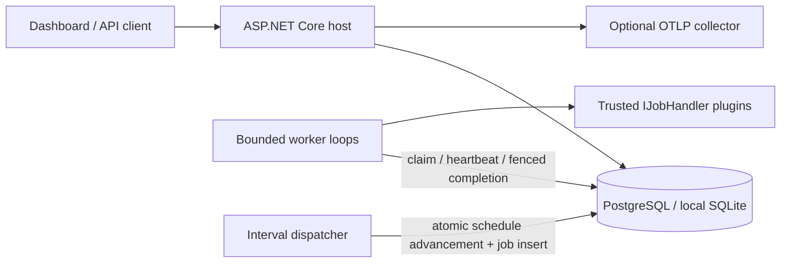

# Runner

A plugin-based durable worker with an operations dashboard, built with .NET 10 and the latest C# for cloud and on-premises deployments. Runs without Quartz, Hangfire, or Redis. Workers keep durable job state in the database and coordinate through it.

**Status:** a working, tested foundation. Complete the operational requirements below before production deployment. Load testing, an independent security review, and validation in a real deployment have not yet been performed.

## Quick start

Requirements: the .NET 10 SDK specified in `global.json`, Bash, and OpenSSL. Node.js is not required.

```bash
dotnet restore Runner.sln --locked-mode
dotnet build Runner.sln -c Release --no-restore
dotnet test tests/Runner.Tests -c Release --no-build
bash scripts/dev.sh
```

The development server uses port 5080. Sign in with the local key stored in `src/Runner.Host/data/operator.key`. The key is generated on first startup and excluded from Git. The SQLite database and cookie keys are persisted under `data/`. Use `scripts/dev.sh` for local development only; do not use the Development environment in production.

The dashboard includes live state counters, handler selection, JSON payloads, delayed dispatch, idempotency keys, state filtering, pagination, cancellation, dead-letter retries, and fixed-interval schedule management. It has no UI framework or CDN dependencies.

## Architecture



- `Runner.Contracts`: a small handler contract with no EF or host dependencies.
- `Runner.Engine`: the durable state machine, conditional SQL ownership, heartbeats, scheduling, retries, and retention.
- `Runner.Host`: the API, cookie and API key authentication, dashboard, readiness checks, and telemetry.
- `Runner.SamplePlugin`: a sample handler loaded from a separate DLL.
- `Runner.Tests`: concurrency and recovery tests against real relational databases.

Use SQLite for single-instance development. Use PostgreSQL for multiple replicas and cloud deployments. Do not share a SQLite file over NFS. The dashboard/API and worker run in the same executable; set `Runner__WorkerEnabled=false` to run only the control plane. There is no separate worker-only executable; restrict network access at the deployment level.

## Execution guarantees

Delivery is **at least once**. Workers claim jobs through conditional database updates, and each claim receives a new token. Heartbeats and completion updates check both the token and lease validity. After a crash, another instance can claim the job once its lease expires. Jobs that crash on their final attempt move to dead-letter state.

Lease fencing protects Runner's state. Plugin writes to external systems are not part of the same transaction: use `JobContext.JobId` for idempotency, a unique constraint, or a transactional outbox for external side effects. An API idempotency key returns the stored job for the same type and payload; a different payload returns 409. When retention removes a successful or cancelled job, its key becomes available again. Deduplication is not permanent.

Retries use bounded exponential backoff with jitter, with a maximum of 20 attempts and a default of 5. Dead-letter jobs are not deleted automatically. Timeouts and cancellation are **cooperative**: handlers must respect the cancellation token. Untrusted code or code that ignores cancellation requires a separate process or container. In-process plugin isolation is not a security boundary.

The scheduler uses fixed UTC intervals of at least 10 seconds. It does not provide cron or time zone scheduling. Missed ticks coalesce into one job; schedule advancement and enqueueing commit in a single transaction. Deleting a schedule does not remove jobs already queued. Keep all host clocks synchronized with NTP; lease checks use the application's UTC clock.

## Writing a plugin

Create a .NET 10 class library that references `Runner.Contracts`:

```csharp
public sealed class InvoiceHandler : IJobHandler
{
    public string Type => "billing.invoice.v1";
    public async Task ExecuteAsync(JobContext job, CancellationToken ct)
    {
        // Validate the JSON and use JobId to make the side effect idempotent.
        await SendIdempotently(job.JobId, job.Payload, ct);
    }
}
```

Deploy the plugin with its dependency DLLs and `.deps.json` file. Configure an explicit allowlist such as `Plugins__0=plugins/YourPlugin.dll`; paths are relative to the executable directory. Do not load a separate copy of the shared `Runner.Contracts.dll` from the plugin directory. Use `Runner.SamplePlugin.csproj` as an example. Concrete handler types are created through scoped dependency injection and can receive framework services. Extend the host composition root to register additional services. Every worker in a deployment must use consistent `Type` identifiers; duplicate types prevent startup. Plugins require a rolling deployment to update; hot reload is not supported. Version payload contracts, and keep old handlers available while jobs for those versions remain queued. Plugins are responsible for validating their payloads.

## API

All `/api/*` requests require an operator cookie or `X-Runner-Key`. Mutations also require `X-Runner-Request: 1`. Never put the key in a URL.

| Method | Path | Operation |
| --- | --- | --- |
| GET | `/api/handlers` | List loaded job types |
| GET | `/api/stats` | Count retained jobs by state |
| GET | `/api/jobs?page=0&state=Running` | List up to 50 jobs; maximum page index is 10000 |
| GET | `/api/jobs/{id}` | Get job details, including the payload |
| POST | `/api/jobs` | Enqueue a job |
| POST | `/api/jobs/{id}/cancel` | Request cooperative cancellation |
| POST | `/api/jobs/{id}/retry` | Reset and requeue a dead-letter or cancelled job |
| GET / POST | `/api/schedules` | List the first 100 schedules or create a schedule |
| DELETE | `/api/schedules/{id}` | Delete a schedule |
| GET | `/health/live`, `/health/ready` | Check the process and database schema access |

Job request:

```json
{"type":"sample.echo","payload":{"delayMs":100},"maxAttempts":5,"delaySeconds":0,"idempotencyKey":"example-001"}
```

Schedule request: `{"type":"sample.echo","payload":{},"intervalSeconds":60}`. The maximum JSON payload is 64 KiB; the maximum HTTP body is 128 KiB. Add `"fail":true` to a `sample.echo` payload to exercise retry and dead-letter behavior. Readiness checks database and schema access; it does not guarantee connectivity to every plugin's external services or worker progress.

## Configuration

Configuration follows ASP.NET Core conventions: appsettings, environment variables with `__` as the nesting separator, and command-line arguments. Keep secret values out of the repository and appsettings files.

| Setting | Default / purpose |
| --- | --- |
| `Storage__Provider` | `Sqlite` or `Postgres` |
| `Storage__ConnectionString` | Local SQLite; supply a PostgreSQL DSN through a secret manager in production |
| `Storage__Initialize` | `false`; create the schema during development |
| `Security__ApiKey` | Required, at least 32 characters; preferably 32 random bytes encoded as 64 hexadecimal characters |
| `Security__KeyDirectory` | Cookie data protection key directory; use a persistent volume with restricted access |
| `Security__TrustedProxy` | Optional single reverse proxy IP; forwarded protocol and client IP headers are accepted only from this address |
| `AllowedHosts` | `localhost;127.0.0.1`; explicitly add the production hostname |
| `Runner__Concurrency` | 4, allowed range 1–128 |
| `Runner__PollMilliseconds` | 1000, minimum 100 |
| `Runner__LeaseSeconds` | 60 |
| `Runner__HeartbeatSeconds` | 15, at most one third of the lease duration |
| `Runner__JobTimeoutSeconds` | 300, cooperative |
| `Runner__RetentionDays` | 14; deletes only succeeded and cancelled jobs |
| `Runner__WorkerEnabled` | true |
| `Telemetry__OtlpEnabled` | false; enable to export traces and metrics |
| `OTEL_EXPORTER_OTLP_ENDPOINT` | Collector address, using standard SDK configuration |

The `Runner` ActivitySource and Meter expose `runner.jobs.finished` and `runner.jobs.duration`, alongside ASP.NET request and runtime metrics. `runner.jobs.finished` measures local execution completions rather than durable job counts. Log scopes include JobId, JobType, and Attempt. API error responses exclude exceptions and payloads. Plugin exceptions are logged; plugins must avoid logging secrets.

## Cloud and on-premises deployment

The same host can run on Docker, Kubernetes, Linux systemd, or Azure Container Apps. The image is configured to run as the .NET non-root user. Deployment to a real cloud account has not been performed.

```bash
# Export secrets securely: POSTGRES_PASSWORD, RUNNER_API_KEY.
# RUNNER_ALLOWED_HOSTS must include your production DNS name.
docker compose up --build -d
```

Compose runs one initialization job after PostgreSQL passes its health check, then starts Runner. PostgreSQL's port is not published to the host; Runner binds only to 127.0.0.1. In production, place a TLS reverse proxy in front of Runner and prevent direct access to the application container. Set `Security__TrustedProxy` to the actual proxy IP. Production cookies require HTTPS; browser login will not work over plain HTTP. You can use loopback HTTP with an API key for health and API smoke checks.

For initial schema setup, run `dotnet Runner.Host.dll --schema` in the publish directory to generate SQL for the selected provider, then have a database operator apply the script. Alternatively, use `--initialize` in one controlled bootstrap process. `EnsureCreated` only bootstraps an empty database; it is **not a schema upgrade or migration system**. Add versioned migrations and a rollout plan before changing the schema. Restrict the runtime database role to DML permissions on the existing schema; use a separate DDL role for bootstrap. For PostgreSQL connections over untrusted networks, use `SSL Mode=VerifyFull` with the appropriate CA.

Before production, validate database backup and restore procedures, resource limits and load behavior, TLS, network policy, secret rotation, the telemetry collector, alert thresholds for queue age/dead-letter/lease loss, schema rollout, graceful draining, and plugin contract compatibility. Share cookie keys across replicas and manage encryption at rest through the platform or KMS. Rotating the API key does not immediately revoke existing eight-hour cookies: immediate session revocation requires cookie key ring rotation or an additional authentication revocation mechanism. Built-in authentication has a single operator role; multi-user RBAC and audit requirements need an OIDC gateway and centralized audit integration. Restrict access before exposing the service to the public internet.

## Cost considerations

Start with a single machine and SQLite. For durable operation across multiple replicas, use PostgreSQL through an existing database, a small VM, or a suitable managed plan. A cache is optional. Redis or Azure cache eviction makes them unsuitable as the primary job store for this design. A DynamoDB adapter is not implemented; it would require separate storage and management layers supporting conditional writes, leases, schedule transactions, and indexed queries. Free tiers and Azure/AWS pricing depend on the account and region; free operation is not guaranteed.

## Validation

```bash
dotnet test tests/Runner.Tests -c Release
# This connection role needs CREATEDB to create and delete isolated test databases:
TEST_POSTGRES='Host=localhost;Username=postgres;Password=...' dotnet test tests/Runner.Tests -c Release
python3 scripts/smoke.py
# Use an empty database dedicated to testing; the smoke test does not delete it automatically.
SMOKE_POSTGRES='Host=localhost;Database=runner_smoke;Username=postgres;Password=...' python3 scripts/smoke.py
dotnet publish src/Runner.Host -c Release -o artifacts/publish
docker build -t runner:local .
```

Store tests cover concurrent claims, lease takeover and fencing, rejection of expired completion updates, retries and dead-letter handling, crash recovery on the final attempt, cancellation, atomic schedule dispatch, retention, and unique idempotency keys. The smoke test launches a real host and exercises API authentication, antiforgery login, plugin loading and execution, retries, cancellation, and schedule dispatch. CI tests both database providers.
