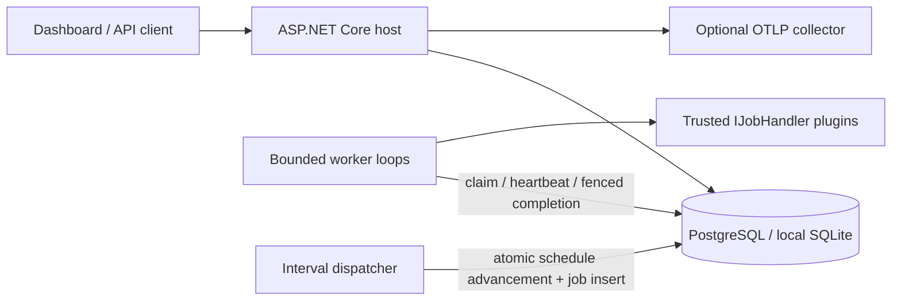

# Runner

.NET 10 / C# latest ile cloud ve on-prem için plugin tabanlı, dashboard içeren durable worker. Quartz, Hangfire veya Redis gerektirmez. Worker belleğinde kalıcı job durumu tutulmaz; süreçler DB üzerinden koordinasyon yapar.

**Durum:** çalışan ve test edilen başlangıç platformu. Production kurulumu için aşağıdaki operasyon gereksinimleri tamamlanmalıdır; yük testi, bağımsız güvenlik incelemesi ve gerçek deployment doğrulaması henüz yapılmadı.

## Hızlı başlangıç

Gerekenler: `global.json` ile eşleşen .NET 10 SDK, Bash, OpenSSL. Node gerekmez.

```bash
dotnet restore Runner.sln --locked-mode
dotnet build Runner.sln -c Release --no-restore
dotnet test tests/Runner.Tests -c Release --no-build
bash scripts/dev.sh
```

Geliştirme sunucusu 5080 portunu kullanır. Giriş için `src/Runner.Host/data/operator.key` dosyasındaki yerel anahtarı kullanın. Anahtar ilk çalıştırmada üretilir, Git'e alınmaz. SQLite DB ve cookie anahtarları `data/` altında korunur. `scripts/dev.sh` yalnızca yerel geliştirme içindir; production'da Development ortamını kullanmayın.

Dashboard: canlı durum sayaçları, handler seçimi, JSON payload, gecikmeli dispatch, idempotency key, durum filtresi, sayfalama, cancellation, dead-letter retry ve sabit aralıklı schedule yönetimi. UI framework/CDN bağımlılığı yoktur.

## Mimari



- `Runner.Contracts`: küçük handler sözleşmesi; EF/host bağımlılığı yok.
- `Runner.Engine`: kalıcı state machine, conditional SQL ownership, heartbeat, scheduler, retry ve retention.
- `Runner.Host`: API, cookie / API key authentication, dashboard, readiness ve telemetry.
- `Runner.SamplePlugin`: ayrı DLL'den yüklenen örnek handler.
- `Runner.Tests`: gerçek ilişkisel DB üzerinde concurrency ve recovery testleri.

Tek instance geliştirmede SQLite kullanın. Birden çok replica / cloud deployment için PostgreSQL kullanın. SQLite dosyasını NFS üzerinde paylaşmayın. Dashboard/API ve worker aynı executable içindedir; `Runner__WorkerEnabled=false` ile yalnız control plane çalıştırılabilir. Worker-only deployment ayrı executable değildir; network erişimini deployment seviyesinde kısıtlayın.

## Çalışma garantileri

Teslimat **at least once**. Worker claim işlemi DB'de conditional update ile yapılır; her claim yeni token alır. Heartbeat ve completion hem token hem lease geçerliliğini kontrol eder. Crash sonrası lease süresi dolunca başka instance işi alabilir. Son denemede crash olan işler dead-letter olur.

Lease fencing yalnız Runner state'ini korur. Plugin'in başka sistemlere yaptığı yazımlar transactional değildir: dış side effect için `JobContext.JobId` ile idempotency, unique constraint veya transactional outbox kullanın. API idempotency key, aynı type/payload için saklanan işi döndürür; farklı payload için 409. Başarılı/iptal edilmiş iş retention ile silindiğinde key de serbest kalır. Sonsuza kadar dedup garantisi yoktur.

Retry: sınırlı exponential backoff + jitter, maksimum 20 deneme (varsayılan 5). Dead-letter otomatik silinmez. Timeout ve cancel **cooperative**; handler cancellation token'a uymalıdır. Güvenilmeyen veya token'ı yok sayan kod için ayrı process/container gerekir. App içi plugin isolation bir güvenlik sınırı değildir.

Scheduler cron/timezone motoru değildir: UTC ile 10 saniye ve üzeri sabit aralıklar. Kaçırılan tick'ler tek işe birleştirilir; schedule advancement + enqueue tek transaction'dır. Schedule silmek kuyruğa girmiş işleri silmez. Tüm host saatlerini NTP ile senkron tutun; lease kontrolleri UTC uygulama saati kullanır.

## Plugin yazma

`Runner.Contracts` referanslı .NET 10 class library oluşturun:

```csharp
public sealed class InvoiceHandler : IJobHandler
{
    public string Type => "billing.invoice.v1";
    public async Task ExecuteAsync(JobContext job, CancellationToken ct)
    {
        // JSON'u doğrulayın; JobId ile side effect'i idempotent yapın.
        await SendIdempotently(job.JobId, job.Payload, ct);
    }
}
```

Plugin'i dependency DLL'leri ve `.deps.json` ile deploy edin. `Plugins__0=plugins/YourPlugin.dll` gibi açık allowlist tanımlayın; path'ler executable dizinine göredir. Ortak `Runner.Contracts.dll` dosyasının plugin klasöründen kopyasını yüklemeyin. `Runner.SamplePlugin.csproj` örneğini kullanın. Handler concrete tipleri scoped DI ile oluşturulur; framework servisleri injection ile kullanılabilir. Ek servis kayıtları için host composition root'u genişletin. Her `Type` deployment içindeki tüm worker'larda aynı olmalı; duplicate type başlangıcı durdurur. Hot reload yok: yeni plugin için rolling deployment gerekir. Payload contract'larını version'layın; sırada eski version job varken handler'ı kaldırmayın. Plugin koduna payload validation sorumluluğu aittir.

## API

Tüm `/api/*` çağrıları operator cookie veya `X-Runner-Key` ister. Mutasyonlarda ayrıca `X-Runner-Request: 1` gerekir. Anahtarı URL'ye koymayın.

| Method | Path | İşlem |
| --- | --- | --- |
| GET | `/api/handlers` | Yüklenen job type'ları |
| GET | `/api/stats` | Retained job durum sayıları |
| GET | `/api/jobs?page=0&state=Running` | En çok 50 kayıt; sayfa üst sınırı 10000 |
| GET | `/api/jobs/{id}` | Payload dahil job detayı |
| POST | `/api/jobs` | Enqueue |
| POST | `/api/jobs/{id}/cancel` | Cooperative cancellation isteği |
| POST | `/api/jobs/{id}/retry` | Dead-letter / cancelled işi sıfırlayıp yeniden sırala |
| GET / POST | `/api/schedules` | İlk 100 schedule / schedule oluştur |
| DELETE | `/api/schedules/{id}` | Schedule sil |
| GET | `/health/live`, `/health/ready` | Process / DB schema erişimi |

Job request:

```json
{"type":"sample.echo","payload":{"delayMs":100},"maxAttempts":5,"delaySeconds":0,"idempotencyKey":"example-001"}
```

Schedule request: `{"type":"sample.echo","payload":{},"intervalSeconds":60}`. Maksimum JSON payload 64 KiB, HTTP body 128 KiB. `sample.echo` payload'ına `"fail":true` ekleyerek retry/dead-letter deneyebilirsiniz. Readiness DB ve schema erişimini ölçer; tüm plugin'lerin harici servislerine erişim veya worker ilerlemesi için garanti değildir.

## Konfigürasyon

ASP.NET Core config düzeni: appsettings + environment variables (`__` nested separator) + command line. Secret değerleri repository'ye veya appsettings'e yazmayın.

| Ayar | Varsayılan / anlamı |
| --- | --- |
| `Storage__Provider` | `Sqlite` veya `Postgres` |
| `Storage__ConnectionString` | Local SQLite; production'da secret manager üzerinden PostgreSQL DSN |
| `Storage__Initialize` | `false`; geliştirmede schema oluşturma |
| `Security__ApiKey` | Zorunlu, en az 32 karakter; tercihen 32 random byte / 64 hex karakter |
| `Security__KeyDirectory` | Cookie data-protection key dizini; kalıcı ve erişimi kısıtlı volume kullanın |
| `Security__TrustedProxy` | Opsiyonel tek reverse proxy IP; forwarded proto/for sadece bu adresten kabul edilir |
| `AllowedHosts` | `localhost;127.0.0.1`; production hostname'i açıkça ekleyin |
| `Runner__Concurrency` | 4, sınır 1–128 |
| `Runner__PollMilliseconds` | 1000, en az 100 |
| `Runner__LeaseSeconds` | 60 |
| `Runner__HeartbeatSeconds` | 15, lease'in en fazla üçte biri |
| `Runner__JobTimeoutSeconds` | 300, cooperative |
| `Runner__RetentionDays` | 14; yalnız succeeded/cancelled silinir |
| `Runner__WorkerEnabled` | true |
| `Telemetry__OtlpEnabled` | false; true olduğunda traces + metrics export |
| `OTEL_EXPORTER_OTLP_ENDPOINT` | Collector adresi; SDK standart config'i |

`Runner` ActivitySource / Meter: `runner.jobs.finished` ve `runner.jobs.duration`, ASP.NET request ve runtime metrics. `runner.jobs.finished` lokal execution bitişlerini ölçer; kalıcı job sayısı değildir. Log scope'ları JobId/JobType/Attempt içerir. API hata yanıtlarında exception/payload yoktur; plugin exception'ları loglanır, plugin'ler secret loglamamalıdır.

## Cloud / on-prem deploy

Docker, Kubernetes, Linux systemd veya Azure Container Apps üzerinde aynı host çalışır. İmaj .NET non-root kullanıcısıyla çalışır. Gerçek bir cloud hesabına deploy yapılmadı.

```bash
# Secret'ları güvenli şekilde export edin: POSTGRES_PASSWORD, RUNNER_API_KEY.
# RUNNER_ALLOWED_HOSTS production DNS adınızı içermeli.
docker compose up --build -d
```

Compose PostgreSQL health check sonrası tek initialization job çalıştırır, ardından Runner başlar. PostgreSQL portu host'a açılmaz; Runner portu yalnız 127.0.0.1'e bind edilir. Production'da önüne TLS reverse proxy koyun; app container'a doğrudan erişimi engelleyin. `Security__TrustedProxy` actual proxy IP olmalı. Production cookie HTTPS ister; düz HTTP üzerinde browser login'i çalışmaz. Health/API smoke için API key ile loopback HTTP kullanabilirsiniz.

Şema başlangıcı için: publish dizininde `dotnet Runner.Host.dll --schema` ile provider'a uygun SQL üretin; DB operatörü script'i uygulasın. Alternatif: tek kontrollü bootstrap sürecinde `--initialize`. `EnsureCreated` yalnız boş DB bootstrap'ıdır; **schema upgrade/migration sistemi değildir**. Şema değişmeden önce version'lı migration + rollout planı eklenmelidir. Runtime DB rolü mevcut şemada DML yetkileriyle sınırlanmalı; bootstrap ayrı DDL rolü kullanmalı. PostgreSQL bağlantısında güvenilmeyen ağda `SSL Mode=VerifyFull` ve uygun CA kullanın.

Production öncesi: DB backup + restore tatbikatı, kaynak limitleri ve yük testi, TLS, network policy, secret rotation, telemetry collector, alarm eşikleri (queue age/dead-letter/lease loss), schema rollout, graceful drain ve plugin contract uyumluluğu doğrulanmalı. Cookie key'lerini replica'lar arasında paylaşın; at-rest key şifrelemesini platform/KMS ile yönetin. Anahtar rotasyonu mevcut 8 saatlik cookie'leri hemen iptal etmez: acil session revoke için cookie key ring rotasyonu veya process-level auth revocation ekleyin. Built-in auth tek operator rolüdür; çok kullanıcılı RBAC/audit ihtiyaçları için OIDC gateway ve merkezi audit entegrasyonu ayrıca gerekir. Genel internete doğrudan açmayın.

## Maliyet seçimi

Başlangıç: tek makine + SQLite. Dayanıklı çok replica: PostgreSQL (mevcut DB, küçük VM veya uygun managed plan). Cache zorunlu değil. Redis/Azure cache eviction nedeniyle primary job store olmamalı. DynamoDB adapter henüz yok; conditional write / lease / schedule transaction ve query index semantiklerini uygulayan ayrı storage + yönetim katmanı gerekir. Free tier ve Azure/AWS fiyatları hesap/bölgeye göre değişir; ücretsiz çalışma garantisi yoktur.

## Doğrulama

```bash
dotnet test tests/Runner.Tests -c Release
# İzole test DB'leri oluşturup silmek için bu connection rolüne CREATEDB gerekir:
TEST_POSTGRES='Host=localhost;Username=postgres;Password=...' dotnet test tests/Runner.Tests -c Release
python3 scripts/smoke.py
# Sadece test için ayrılmış boş DB kullanın; smoke DB'yi otomatik silmez.
SMOKE_POSTGRES='Host=localhost;Database=runner_smoke;Username=postgres;Password=...' python3 scripts/smoke.py
dotnet publish src/Runner.Host -c Release -o artifacts/publish
docker build -t runner:local .
```

Store testleri: concurrent claim, lease takeover/fencing, expired completion rejection, retry/dead-letter, final-attempt crash recovery, cancellation, atomic schedule dispatch, retention ve unique idempotency. Black-box smoke gerçek host ile API auth, antiforgery login, plugin loading/execution, retry, cancellation ve schedule dispatch çalıştırır. CI her iki DB provider'ını test eder.
