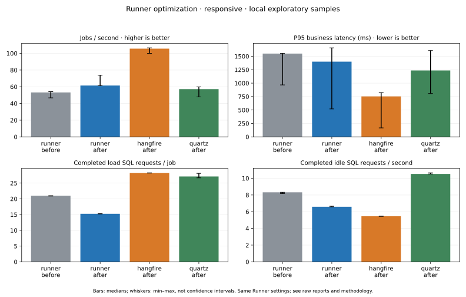
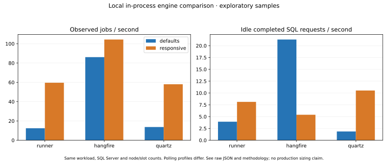

# Runner / Hangfire / Quartz engine benchmarks

This is a reproducible SQL Server comparison tool, separate from Runner's application/runtime dependencies. It uses the **real Runner worker**, Hangfire.SqlServer and Quartz's persistent SQL Server store, with two independent worker processes per engine by default. It does not install Hangfire/Quartz into Runner or replace its scheduler.

## Matched settings: worker optimization results

[Three-sample before/after table and CSV](optimization-2026-10-29.md) compare the existing worker with optimized revision `2d00787`, alongside fresh Hangfire/Quartz runs. Every case uses 200 jobs, a 10 ms body, two worker processes/eight slots each, 20 warm-up jobs, 35 seconds settling and 30 seconds idle measurement. All use the **responsive** profile; Runner's effective polling/lease/history settings are identical before and after. Engine order rotates across three full runs; before/after groups are interleaved. No other test/build runs overlap these timed windows. The hardware and SQL Server remain shared development resources.

The observed Runner medians changed from **53.17 to 61.46 jobs/s (+15.6%)**, **20.990 to 15.245 completed load SQL requests/job (−27.4%)**, and **8.320 to 6.592 completed idle SQL requests/s (−20.8%)**. Business P95 medians were 1,550 ms before and 1,400 ms after, with overlapping sample ranges. All 2,400 measured bodies and durable completions were verified; no duplicates were observed.

Hangfire still had higher median throughput (105.63 jobs/s), lower business P95 (753 ms) and fewer completed idle requests (5.457/s) than optimized Runner in this sample. Runner used about **46% fewer completed load SQL requests/job than Hangfire** (28.18), and **44% fewer than Quartz** (27.10). Quartz's throughput median was 57.16 jobs/s and its business P95 median was 1,237 ms. These measurements show specific tradeoffs; fewer requests do not establish lower SQL CPU, logical IO or total database cost. Histories/acquisition protocols differ as described below.



The bars show medians and whiskers show observed min–max, **not confidence intervals**. [Raw JSON](raw/), [run order](raw/optimization-run-order-2026-10-29.json) and [build provenance/checksums](raw/optimization-build-provenance-2026-10-29.json) are preserved. The before worker binary reports platform revision `2287330`; its Engine/Contracts source is unchanged by the original benchmark commit `5362ba0`. Both sides use the same benchmark adapter sources/pinned dependencies. The new code reduces candidate/body lookups, connection resets, attempt-finalization reads and empty scheduler/heartbeat requests; it retains lease fencing and durable journals. It does not change the default 30-second idle discovery cap or certify deployment capacity.

## Earlier exploratory snapshot


[Measured JSON/CSV/Markdown results](local-2026-10-29.md) cover 200 jobs, two worker processes with eight slots each, a 10 ms body and one sample per engine/profile. The SQL Server 2022 Developer instance and Linux hardware were shared development resources. This is not a multi-host deployment test or a peak-capacity claim. Defaults left only one node executing the short Runner/Quartz burst in this sample; the responsive profile used both. All bodies and durable completions were verified.



Raw reports are preserved under [raw/](raw/). In this sample the default Quartz configuration produced fewer completed idle requests than Runner, while default Hangfire produced lower business latency. In the responsive profile Hangfire showed higher drain throughput and fewer completed idle requests than the other two. These are observations, not universal rankings: acquisition protocols, completion history, timing and sample variance differ. The extra explicit zero-poll Hangfire run confirms the same effective settings as its installed defaults.

## Scope and fairness

Each engine receives a fresh generated database on the same SQL Server instance, the same node/slot counts, and the same in-process async body (`Task.Delay`, then a common completion record). The common completion table lives in a separate results database, excluded from engine DB counters. Its recording cost remains in end-to-end wall time. Native enqueue APIs are used for every engine. Producers run separately from worker nodes; no framework receives a cross-process in-memory notification from the producer.

Runner retains normal job leases, node registration, scheduling/maintenance, attempts and lifecycle journal entries. Hangfire retains normal server processes and state history. Quartz uses its default history settings and removes completed one-shot jobs/triggers. Those persistence features are not equivalent, so query counts alone cannot establish implementation efficiency. HTTP, API authentication/audit middleware, and per-job DLL/script process startup are excluded from **all** adapters. Use the existing `scripts/load_smoke.py` for Runner's API path; do not mix that tool's EF counts with these measurements.

The default body is 10 ms and the default batch has 200 jobs. Workload throughput includes submission, discovery after idle, execution, common completion recording, and the final durable framework state transition. It is **not** a steady-state peak execution-rate claim. Business end-to-end latency runs from the start of each enqueue call to business-body completion, before the common result insert and framework finalization. Warm-up jobs, schemas, and settling are excluded. Missing/duplicate bodies, unexpected producer execution, worker crashes, missing/reset load counters and jobs that do not durably drain reject the case. The common timestamp parameters currently use SqlClient's inferred DateTime precision (approximately 3.33 ms), equally for all adapters; sub-millisecond conclusions are not supported.

## Configuration profiles

| Profile | Runner | Hangfire.SqlServer | Quartz |
| --- | --- | --- | --- |
| `defaults` | Engine defaults; idle discovery cap 30 s. | SQL storage defaults, with installed-schema autodetection. | Persistent clustered store defaults. |
| `responsive` | Idle cap 1 s; minimum polling 1,000 ms. | QueuePollInterval 1 s. | Scheduler idle wait 1 s. |
| `longpoll` | Same as responsive, if selected. | Explicit QueuePollInterval 0 and SlidingInvisibilityTimeout 5 minutes. | Same as responsive, if selected. |

The explicit zero-poll profile can be selected for Hangfire alone. In Hangfire 1.8.25 those values are already the installed defaults, so it is a **confirmation/repeat**, not evidence of a different optimization. The tool records effective settings. QueuePollInterval=0 is a library setting, not a claim that SQL traffic is zero. A 1-second discovery target does not make the frameworks' internal acquisition protocols identical. Defaults may spend much longer discovering the first new jobs; do not interpret that latency as slower business code.

All engines share SQL Server's READ_COMMITTED_SNAPSHOT=ON and SIMPLE recovery for their temporary databases. No server caches are cleared or unrelated server/database settings changed. Warm-up/settling happens for every case. Cases execute sequentially, and engine order rotates across repetitions. Running other tests/loads simultaneously affects the shared server; use dedicated hardware for actionable capacity decisions. Configured nodes/slots and the number of nodes that actually executed business bodies are recorded independently.

## Uniform server-side DB measurement

The tool creates a temporary, filtered SQL Server Extended Events session with the synchronous `package0.event_counter` target. It captures only the generated engine database ID and benchmark producer/worker application-name prefix. No SQL text or credentials are stored. Observer connections and common result-table traffic are excluded from engine counters. Dropped XE events reject the measurement.

- **Completed SQL requests** = `rpc_completed` + `sql_batch_completed`, including connection-reset requests that SQL Server emits. A request/batch may contain several SQL statements. This differs from an EF interceptor's command count.
- SQL and stored-procedure statement-event classes are reported separately. Do not add them to request counts; nesting/statement boundaries differ from request boundaries.
- Active SQL requests and open sessions at the end of each window reveal work still in flight; a low completion count can coexist with a held long-poll connection. End-of-window samples are not averages of active requests.
- Physical bytes read/written come from `sys.dm_io_virtual_file_stats` for that engine database. They include log flushes and background checkpoint work, are cache-dependent, and are not logical IO counts or a complete SQL CPU/resource measure.
- Worker process CPU deltas and summed working sets are reported. They exclude producer and SQL Server CPU; summed working sets can double-count shared pages and are not proportional-set-size measurements.

Each result records raw idle/load windows, effective settings, enqueue duration, drain throughput, P50/P95/P99 business latency, duplicate count, executing-node count, .NET/OS/CPU-count information and pinned package versions. Current adapter pins are Hangfire.SqlServer **1.8.25** and Quartz **4.6.2**; Newtonsoft.Json is explicitly pinned to **13.0.4** instead of accepting Hangfire's vulnerable minimum transitive version. Vulnerability verification remains enabled. Driver selection explicitly uses Microsoft.Data.SqlClient for all three engines. Quartz's release-pinned schema and upstream license are under `tools/Runner.Benchmarks/Sql`.

## Run

Requirements: .NET 10 SDK from `global.json` and a **disposable SQL Server test instance**. The test login needs database creation/drop, server state/DMV access and Extended Events session permissions. The included CI uses SQL Server 2022 Developer. This harness does not currently compare PostgreSQL/SQLite adapters or Azure SQL Database's database-scoped XE model.

```bash
# Supply this from your local secret manager/environment, not a committed file.
export BENCH_MSSQL="$YOUR_DISPOSABLE_SQLSERVER_CONNECTION"

# Fast functional adapter/counter/cleanup validation; never performance evidence.
bash scripts/compare-benchmarks.sh --smoke

# Default: 200 jobs, 10 ms body, two nodes, eight slots/node,
# 20 warm-up jobs, 35 seconds settling, 30 seconds idle measurement,
# defaults + responsive profiles, three repetitions with rotated order.
bash scripts/compare-benchmarks.sh

# Explicit Hangfire zero-poll configuration, if desired.
bash scripts/compare-benchmarks.sh --engines hangfire --profiles longpoll --repetitions 3

# All numeric overrides are bounded by the CLI.
bash scripts/compare-benchmarks.sh --jobs 1000 --nodes 2 --workers 8 \
  --delay-ms 10 --profiles responsive --repetitions 3

python3 scripts/report-benchmarks.py artifacts/benchmarks/<run>.json \
  --output artifacts/benchmarks/comparison
# Optional SVG chart; matplotlib is a documentation-tool dependency only.
python3 scripts/report-benchmarks.py artifacts/benchmarks/<run>.json \
  --output artifacts/benchmarks/comparison --plot
```

JSON is saved after each valid case under ignored `artifacts/benchmarks`. The renderer exports CSV/Markdown medians and an optional SVG; it refuses smoke reports or incompatible workload/timing combinations. Multiple repetitions are necessary to assess variance. A single local run is exploratory and cannot establish a universal winner or a production sizing target. No performance thresholds are asserted in CI: shared runners vary.

For an explicit code optimization comparison, build each **committed** Runner revision separately and keep its binaries and raw reports. Run both with identical workload, timing, polling, lease and journal settings, alternate revision order, and keep other test/load activity stopped. The revision renderer requires at least three Runner samples on each side, preserves sample ranges, and rejects changed Runner effective settings, incompatible environments/workloads, incomplete matrices, repeated input paths and smoke data. It allows only the explicit Runner revision difference; the ordinary renderer above continues to reject mixed revisions.

```bash
python3 scripts/compare-benchmark-revisions.py \
  --before artifacts/benchmarks/<before-run-1>.json artifacts/benchmarks/<before-run-2>.json artifacts/benchmarks/<before-run-3>.json \
  --after artifacts/benchmarks/<after-run-1>.json artifacts/benchmarks/<after-run-2>.json artifacts/benchmarks/<after-run-3>.json \
  --output artifacts/benchmarks/optimization --plot
```

Ranges are observed min–max, not confidence intervals. SQL request savings alone do not establish SQL CPU, logical IO, or latency improvements. Runner retains history/lease/placement/capacity controls, and a 30-second default idle cap still trades cross-node discovery latency for fewer polls. Select the responsive profile for the explicit one-second comparison rather than interpreting a polling configuration change as faster engine code.

Only generated databases named `runner_bench_<GUID>` / `runner_bench_result_<GUID>` and the tool's generated XE sessions are created/dropped. The supplied connection's original database is not overwritten. Normal completion and handled failures stop workers and remove those resources. Forced process/machine termination can leave temporary resources; inspect the generated identifiers before manual cleanup. No scripts publish packages or contact a production service.
